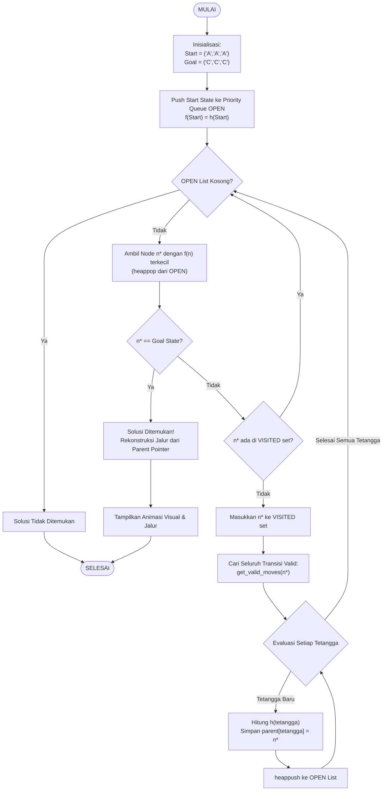

# Pemodelan Graph & Algoritma Greedy Best-First Search (GBFS) pada Tower of Hanoi

Proyek ini disusun untuk memenuhi **Tugas 2 Mata Kuliah Game Development**. Proyek ini mengimplementasikan pemodelan ruang keadaan graf (*State Space Graph*) dan algoritma pencarian **Greedy Best-First Search (GBFS)** untuk menyelesaikan puzzle klasik **Tower of Hanoi (3 Piringan)** secara otomatis dengan animasi visual interaktif berbasis terminal (CLI).

---

## 1. Deskripsi Permasalahan

Tower of Hanoi adalah teka-teki matematis klasik yang terdiri dari **tiga tiang** (dinamakan tiang **A**, **B**, dan **C**) serta **tiga buah piringan** bertingkat dengan ukuran berbeda:
- **Piringan 0**: Ukuran terkecil
- **Piringan 1**: Ukuran sedang
- **Piringan 2**: Ukuran terbesar

### Aturan Permainan:
1. Hanya satu piringan teratas yang boleh dipindahkan dalam satu waktu.
2. Setiap perpindahan mengambil piringan paling atas dari satu tiang dan memindahkannya ke tiang lain.
3. **Piringan yang lebih besar tidak boleh diletakkan di atas piringan yang lebih kecil.**
4. **Kondisi Awal (*Start State*)**: Seluruh piringan bertumpuk teratur di tiang **A** $\rightarrow$ `('A', 'A', 'A')`.
5. **Kondisi Tujuan (*Goal State*)**: Seluruh piringan berhasil dipindahkan ke tiang **C** $\rightarrow$ `('C', 'C', 'C')`.

---

## 2. Pemodelan Graph $G = (V, E)$

Permainan ini dimodelkan ke dalam graf berarah ruang keadaan (*State Space Directed Graph*):

$$G = (V, E)$$

### A. Vertices / Simpul ($V$)
Setiap vertex $v \in V$ merepresentasikan konfigurasi posisi seluruh piringan pada saat tertentu dalam bentuk tuple 3-elemen:

$$\text{State} = (p_0, p_1, p_2)$$

Di mana:
- $p_0$ : Posisi tiang untuk piringan kecil (ukuran 0) $\in \{'A', 'B', 'C'\}$
- $p_1$ : Posisi tiang untuk piringan sedang (ukuran 1) $\in \{'A', 'B', 'C'\}$
- $p_2$ : Posisi tiang untuk piringan besar (ukuran 2) $\in \{'A', 'B', 'C'\}$

Karena terdapat 3 piringan dan masing-masing dapat berada di salah satu dari 3 tiang, total ruang keadaan teoritis adalah:
$$|V| = 3^3 = 27 \text{ kemungkinan state}$$

> **Catatan Struktur Graf**: Jika seluruh 27 state dan edge transisinya divisualisasikan, graf ruang keadaan Tower of Hanoi membentuk fraktal berderajat 3 yang dikenal sebagai **Sierpiński Triangle Graph**.

### B. Edges / Sisi ($E$)
Sebuah edge $e = (u, v) \in E$ merepresentasikan transisi langkah yang valid dari state $u$ ke state $v$ yang mematuhi hukum Tower of Hanoi:
- Mengambil piringan teratas dari tiang asal (*source peg*).
- Menaruhnya di tiang target (*target peg*) hanya jika tiang target kosong atau piringan teratas di tiang target berukuran lebih besar.

---

## 3. Algoritma Greedy Best-First Search (GBFS)

Algoritma Greedy Best-First Search mengeksplorasi ruang pencarian dengan selalu memperluas (*expanding*) simpul yang diperkirakan paling dekat dengan tujuan (*goal*).

### Formulasi Fungsi Evaluasi
Pada Greedy Best-First Search, prioritas eksplorasi ditentukan murni oleh fungsi heuristik:

$$f(n) = h(n)$$

Di mana:
- $n$ : Node / state yang sedang dievaluasi.
- $h(n)$ : Estimasi jarak heuristik dari simpul $n$ menuju simpul tujuan (*Goal*).
- $f(n)$ : Nilai prioritas antrean pada Priority Queue (`heapq`).

Simpul berikutnya $n^*$ dipilih dari antrean terbuka (*OPEN list*) dengan nilai $f(n)$ minimum:
$$n^* = \arg\min_{n \in \text{OPEN}} f(n)$$

### Desain Fungsi Heuristik $h(n)$
Heuristik dirancang dengan memberikan bobot eksponensial $2^i$ berdasarkan ukuran piringan:

$$h(n) = \sum_{i=0}^{k-1} \begin{cases} 0, & \text{jika } \text{state}[i] = \text{goal}[i] \\ 2^i, & \text{jika } \text{state}[i] \neq \text{goal}[i] \end{cases}$$

- **Piringan 0 (Kecil)**: Bobot penalti $2^0 = 1$
- **Piringan 1 (Sedang)**: Bobot penalti $2^1 = 2$
- **Piringan 2 (Besar)**: Bobot penalti $2^2 = 4$

**Alasan Desain Bobot $2^i$:**  
Piringan berukuran lebih besar memiliki penalti lebih berat untuk memaksa algoritma memprioritaskan pemindahan piringan terbesar ke tiang tujuan terlebih dahulu, menyerupai strategi pemecahan masalah manusia.

---

## 4. Flowchart Alur Kerja Algoritma GBFS



---

## 5. Hasil Eksekusi & Lintasan Solusi (17 Langkah)

Berikut adalah lintasan solusi yang dihasilkan oleh algoritma GBFS dari kondisi awal ke tujuan:

| Langkah | State Tuple | Heuristik $h(n)$ | Aksi Perpindahan Piringan |
| :---: | :---: | :---: | :--- |
| **00** | `('A', 'A', 'A')` | $h = 7$ | Kondisi Awal |
| **01** | `('C', 'A', 'A')` | $h = 6$ | Pindahkan Piringan 0 (Kecil) dari Tiang A $\rightarrow$ C |
| **02** | `('C', 'B', 'A')` | $h = 6$ | Pindahkan Piringan 1 (Sedang) dari Tiang A $\rightarrow$ B |
| **03** | `('A', 'B', 'A')` | $h = 7$ | Pindahkan Piringan 0 (Kecil) dari Tiang C $\rightarrow$ A |
| **04** | `('A', 'C', 'A')` | $h = 5$ | Pindahkan Piringan 1 (Sedang) dari Tiang B $\rightarrow$ C |
| **05** | `('C', 'C', 'A')` | $h = 4$ | Pindahkan Piringan 0 (Kecil) dari Tiang A $\rightarrow$ C |
| **06** | `('C', 'C', 'B')` | $h = 4$ | Pindahkan Piringan 2 (Besar) dari Tiang A $\rightarrow$ B |
| **07** | `('A', 'C', 'B')` | $h = 5$ | Pindahkan Piringan 0 (Kecil) dari Tiang C $\rightarrow$ A |
| **08** | `('A', 'B', 'B')` | $h = 7$ | Pindahkan Piringan 1 (Sedang) dari Tiang C $\rightarrow$ B |
| **09** | `('C', 'B', 'B')` | $h = 6$ | Pindahkan Piringan 0 (Kecil) dari Tiang A $\rightarrow$ C |
| **10** | `('C', 'A', 'B')` | $h = 6$ | Pindahkan Piringan 1 (Sedang) dari Tiang B $\rightarrow$ A |
| **11** | `('A', 'A', 'B')` | $h = 7$ | Pindahkan Piringan 0 (Kecil) dari Tiang C $\rightarrow$ A |
| **12** | `('A', 'A', 'C')` | $h = 3$ | Pindahkan Piringan 2 (Besar) dari Tiang B $\rightarrow$ C |
| **13** | `('C', 'A', 'C')` | $h = 2$ | Pindahkan Piringan 0 (Kecil) dari Tiang A $\rightarrow$ C |
| **14** | `('C', 'B', 'C')` | $h = 2$ | Pindahkan Piringan 1 (Sedang) dari Tiang A $\rightarrow$ B |
| **15** | `('A', 'B', 'C')` | $h = 3$ | Pindahkan Piringan 0 (Kecil) dari Tiang C $\rightarrow$ A |
| **16** | `('A', 'C', 'C')` | $h = 1$ | Pindahkan Piringan 1 (Sedang) dari Tiang B $\rightarrow$ C |
| **17** | `('C', 'C', 'C')` | $h = 0$ | Pindahkan Piringan 0 (Kecil) dari Tiang A $\rightarrow$ C (🎉 GOAL) |

---

## 6. Analisis Akademis: Mengapa 17 Langkah vs Optimal 7 Langkah?

1. **Solusi Teoretis Terpendek ($2^n - 1$)**:  
   Secara analitis matematis, jumlah perpindahan minimum untuk memindahkan $n=3$ piringan adalah $2^3 - 1 = \mathbf{7\text{ langkah}}$.
2. **Karakteristik Greedy Best-First Search (Sub-Optimal)**:  
   GBFS **tidak menjamin solusi terpendek** (*not optimal*). Karena fungsinya $f(n) = h(n)$ hanya memprioritaskan pengurangan estimasi saat ini tanpa mempertimbangkan akumulasi biaya langkah yang sudah ditempuh ($g(n)$).
3. **Mekanisme Kelengkapan (*Completeness*)**:  
   Meskipun tidak menghasilkan rute terpendek, algoritma ini **terbukti Complete** (pasti menemukan solusi) karena didukung oleh struktur data `visited` set yang mencegah terbentuknya siklus tak berujung (*infinite loop*).

---

## 7. Fitur Program Terminal

Program `tower_of_hanoi.py` dilengkapi dengan 3 mode utama:
1. 🎮 **Playable Game Mode (Main Manual)**:
   - Pemain memindahkan piringan sendiri di terminal (cth: ketik `A C` untuk memindahkan piringan dari tiang A ke C).
   - Validasi aturan langsung (mencegah piringan besar ditaruh di atas piringan kecil).
   - Fitur bantuan: `hint` (minta saran langkah terbaik dari AI GBFS), `undo`, dan `reset`.
2. 🤖 **AI Solver Mode (Animasi Otomatis)**:
   - Visualisasi grafis ASCII tiang dan piringan langkah demi langkah secara mulus (*auto-play* atau tekan Enter).
   - Menampilkan nilai $h(n)$ dan deskripsi perpindahan di setiap frame.
3. 📊 **Mode Analisis**:
   - Menampilkan rekapitulasi data ruang keadaan graf dan perbandingan teoritis.

---

## 8. Panduan Menjalankan Program

### Prasyarat
- Python 3.8 atau yang lebih baru.
- Hanya menggunakan pustaka bawaan standar Python (`heapq`, `time`, `os`, `sys`), **tanpa perlu install library tambahan**.

### Langkah Menjalankan:
1. Buka Terminal / PowerShell / Command Prompt.
2. Masuk ke direktori proyek:
   ```bash
   cd "Tugas 2"
   ```
3. Jalankan file program:
   ```bash
   py tower_of_hanoi.py
   ```
